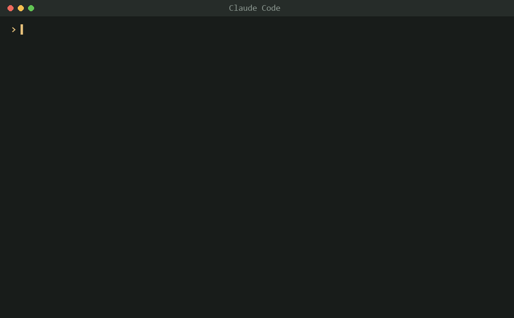
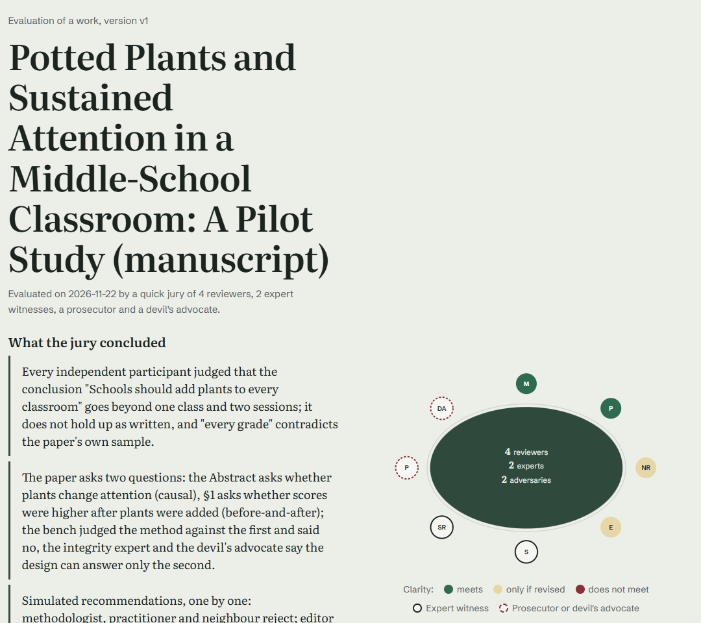
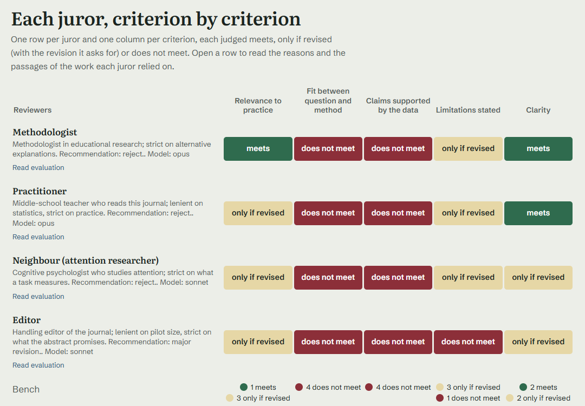
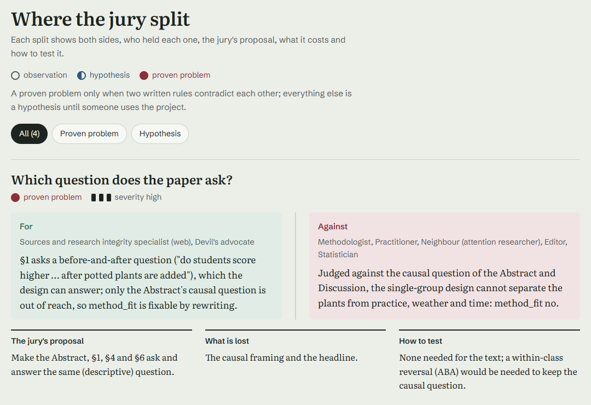
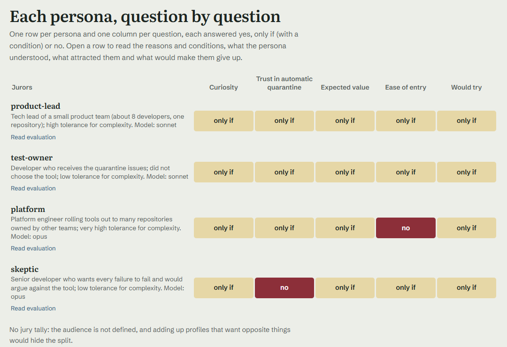
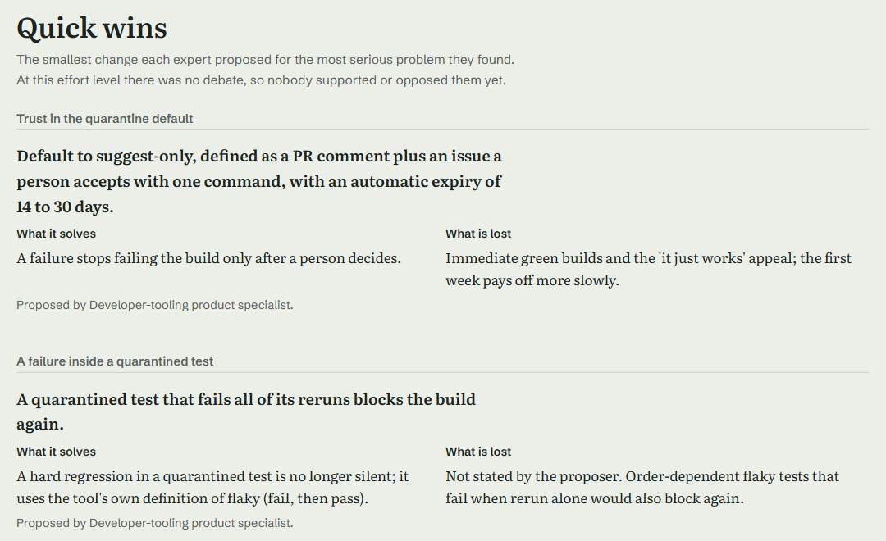

# little-jury

A [Claude Code](https://code.claude.com) skill that puts your project or your work in front of a **little jury**, a mock jury of synthetic personas (jurors, expert witnesses, a prosecutor and a devil's advocate, with a judge running the sessions) that review it in isolated rounds and hand you an HTML report with the tensions, risks, gaps and what to test or revise first.



It is not only for software. It works on:

- **a concept** that is still on paper (a game, an app, a product, a service, a business);
- **an existing system**, described from its code, docs and comments;
- **a planned change** to an existing system, described in a plan file;
- **a piece of work** judged as written: a scientific paper, a book or chapter, a thesis, an exam and its answer key, an exam answer.

The jury works in one of two ways. In the **audience** family, the personas react as your public would (players, users, readers, students facing an exam). In the **criteria** family, a bench of jurors judges the work against explicit criteria, like a peer review, a thesis committee or a grader with an answer key.

The jury deliberates; **you decide**. The report never gives a verdict.

**Who is in the room.** The **judge** (the Claude session that runs the panel) writes the prompts, keeps the record and writes the summary, but never votes. The **jurors** are the personas who react as your audience, or the bench that applies your criteria. In an existing system, its current users are **witnesses**: they say how they use it today before judging. **Expert witnesses** give technical opinion, and one of them can check facts on the web. The **prosecutor** argues the strongest case against the project, and the **devil's advocate** challenges whatever the panel agreed on too easily, including the judge's own summary. Your documents are the **exhibits**; reviews you made in other AI tools can join as **amicus briefs**. The personas themselves are never told they are in a trial.

## Two examples

Both were run with the skill itself at the **quick** effort level (8 and 12 persona calls, 20 and 27 minutes) on fictional material. The terminal scenes in the animation above reproduce the text of the real session; the report images are screenshots of the real reports.

**Outside software: a pilot study judged like a peer review.** A short paper on potted plants and attention in one classroom, judged by a bench of four reviewers against the journal's five criteria (criteria family, type work). The cover letter, which argues for the paper, was kept out of the jury's reach.



Each juror judges each criterion: meets, only if revised (with the revision it asks for) or does not meet.



Where the jury split, each side is shown with who held it, the jury's proposal, what it costs and how to test it.



**Software: a developer tool concept.** Flakeguard, a CLI and CI bot that quarantines flaky tests automatically. The author asked whether teams would trust automatic quarantine, and had not decided between small product teams and platform teams, so the report shows the split instead of a tally.





## What it is good at, and what it is not

**Good at:** contradictions between your own rules, dominant strategies and loopholes, gaps in the specification, audience splits (what attracts one profile and drives away another), the smallest test for your main hypothesis, quick wins (the smallest change that would solve each problem, and what it costs), sentences of your pitch that readers misunderstand, and checking external facts against their sources (store rules, platform docs). Trademark registries often cannot be checked automatically (interactive forms, CAPTCHAs); the report marks them [not verified].

**Not:** telling you whether people will actually like it, predicting market interest, or giving approval percentages. Simulated opinions are not research, and the report says so. That is also why the personas do not rate the project from 1 to 5: each one answers a few questions (would you want to know more, would it be worth it, would you try it) with **yes**, **no** or **only if…**, and the condition behind an "only if" is usually the most useful line in the report. A persona the question does not fit (someone who would only get notifications, say) answers **does not apply**, with the reason, and stays out of the count.

## How it works

1. **You ask once.** Run `/little-jury` at the root of your project, optionally followed by what you want to find out. The skill reads your material and asks one block of questions: who the project is for, what you want to find out (it only confirms it if you already said it, and offers a general evaluation of the project if you did not), what worries you, how much effort to spend, and anything the material does not answer.
2. **It writes neutral inputs.** It strips your arguments in favor of the idea, your comparisons with other products and the justifications in code comments, and records what it removed in `prep/removed.md` so you can check later.
3. **It runs the jury in isolation.** It assembles a `panel/` folder and starts a separate Claude Code session inside it. That session cannot read the rest of your project: reads outside the folder are blocked, the project's `CLAUDE.md` files and git history are kept out of its context, and the personas run as subagents with no tools at all.
4. **Five rounds:** **Opening** (first impressions), **Testimony** (detailed analysis by jurors, expert witnesses and the prosecutor), **Cross-examination** (your rules or claims put to the test in scenarios), **Deliberation** (the devil's advocate challenges the consensus, then a debate) and **the judge's summary**. You pick the **effort level**: **quick** (4 jurors and 2 experts, no scenarios and no debate, about 12 to 20 calls, a cheap first reading), **standard** (the default, all five rounds, about 50 to 70 calls) or **deep** (11 jurors, 5 experts, two prosecutors, more scenarios and debate points, about 90 to 130 calls). By default there are no stops; if you ask for the optional **checkpoints** in the question block, the run pauses after round 1 (to see whether the voices are distinct) and before the debate (to adjust the agenda), and `/little-jury` continues it.
5. **You get the report.** `report.html` opens in your browser. The `.md` files next to it are the jury's full record, written for Claude to pick up in a later session.

The skill talks to you and writes everything in the language you use with Claude Code. English is the default.

**Revised versions.** Run `/little-jury` again after revising the project and the skill treats it as a re-evaluation: the same persona profiles and models (fresh instances that know nothing of the earlier run), the earlier problems checked against the new text, the changed sections checked for new problems of their own, and a report section showing each one as resolved, partly resolved or unresolved, plus the new problems the changes created.

## Requirements

- **Claude Code 2.1.271 or later**: the isolation relies on `blockReadsOutsideWorkingDirectories` (2.1.257) and on subagents with `omitClaudeMd` (2.1.271). Check with `claude --version`.
- **Python 3.9 or later**, available as `python` or `python3`.
- **The `claude` command on your `PATH`**: the skill starts the isolated session with `claude -p`.
- **Usage budget:** a standard jury makes roughly **50 to 70 agent calls** (quick: 12 to 20; deep: 90 to 130) and can take from tens of minutes to a few hours. It may cross more than one usage window of your plan; if it stops at a limit, `/little-jury` resumes from where it stopped.

## Installation

Pick one way. All of them need **Python 3.9 or later** and the **`claude` command** on your computer (see Requirements).

### Option 1: as a plugin (recommended)

In Claude Code, send:

```text
/plugin install little-jury --marketplace HeitorTomaz/little-jury
```

That works in one step on Claude Code 2.1.275 or later. On older versions, add the marketplace first:

```text
/plugin marketplace add HeitorTomaz/little-jury
/plugin install little-jury@heitortomaz
```

Plugins prefix their skills with the plugin name, so the command becomes **`/little-jury:little-jury`**. You can also just ask in plain words ("put this paper in front of a little jury").

### Option 2: ask Claude Code to install it as a personal skill

Open Claude Code anywhere and send:

```text
Install the little-jury skill for me: clone https://github.com/HeitorTomaz/little-jury into my personal
skills folder, so that SKILL.md ends up at ~/.claude/skills/little-jury/SKILL.md. Then check that
/little-jury shows up; if it doesn't, run /reload-skills.
```

The command is then **`/little-jury`**. To install it only for one repository, ask for `.claude/skills/little-jury/` inside that repository instead. Use either the plugin or the personal skill, not both: with both, the skill shows up twice.

### Option 3: install it manually

**macOS and Linux**

```bash
git clone https://github.com/HeitorTomaz/little-jury.git ~/.claude/skills/little-jury
```

**Windows (PowerShell)**

```powershell
git clone https://github.com/HeitorTomaz/little-jury.git "$env:USERPROFILE\.claude\skills\little-jury"
```

**Without git:** download the repository as a ZIP (Code > Download ZIP), extract it, and rename the folder to `little-jury` so that the path is `~/.claude/skills/little-jury/SKILL.md` (on Windows, `%USERPROFILE%\.claude\skills\little-jury\SKILL.md`).

Claude Code picks up new skills during the session. If `/little-jury` does not appear in the `/` menu, run `/reload-skills`.

### Claude Code in the desktop app, step by step

If you use Claude Code in the **Claude desktop app** and have never used a terminal, follow these steps once.

1. **Install the desktop app** from [claude.com/download](https://claude.com/download), sign in, and open **Claude Code** (the Code tab).
2. **Install Python** from [python.org/downloads](https://www.python.org/downloads/). On Windows, tick **"Add python.exe to PATH"** on the first screen of the installer.
3. **Install the Claude Code command-line tool.** The jury runs in a second, isolated Claude Code session, which the skill starts with the `claude` command; the desktop app alone may not provide it. Follow the official [quickstart](https://code.claude.com/docs/en/quickstart), or paste one line:
   - **Windows:** open *PowerShell* from the Start menu and paste `irm https://claude.ai/install.ps1 | iex`
   - **macOS:** open *Terminal* and paste `curl -fsSL https://claude.ai/install.sh | bash`

   Then **quit and reopen the desktop app**, so it sees the new tools.
4. **Open your project folder** in a Claude Code session in the app (the folder that holds your document, paper, plan or code).
5. **Install little-jury.** Click **+** next to the message box, then **Plugins**, and add the plugin from `HeitorTomaz/little-jury` if the app offers it. If you do not see that option, send this message instead:

   ```text
   Install the little-jury plugin: run claude plugin install little-jury --marketplace HeitorTomaz/little-jury,
   then check that python --version and claude --version both work.
   ```
6. **Use it.** Type `/little-jury:little-jury` followed by what you want to find out, or just write "put my document in front of a little jury". The skill asks you one block of questions; for a first try, choose the **quick** effort level.
7. **Allow the edits.** The skill writes its files in two folders, `prep/` and `panel/`, inside your project. The app asks before each write unless you allow edits for the session.

When the jury finishes, the report opens in your browser.

### Updating

- **Plugin:** open `/plugin`, go to the marketplace `heitortomaz` and update it, or reinstall the plugin.
- **Personal skill:** `git -C ~/.claude/skills/little-jury pull` (on Windows: `git -C "$env:USERPROFILE\.claude\skills\little-jury" pull`).

## Usage

Open Claude Code **at the root of your project** and run `/little-jury`. There is one command; what you write after it is up to you:

| Example | What happens |
|---|---|
| `/little-jury` | evaluates the concept document (no code yet) or the existing system (there is code); the questions offer a general evaluation |
| `/little-jury I want to know whether first-time users get the scoring` | the same, aimed at what you want to find out |
| `/little-jury docs/my-change-plan.md` | evaluates the planned change described in that file, against the current system |

The skill looks at the folder before doing anything: with no `panel/`, it prepares one; with a panel that is assembled or unfinished (stopped at a limit or at a checkpoint), it runs or resumes it; with a finished run, it offers a re-evaluation of your revised version. Plain requests work too: "put this concept in front of a little jury", "continue the panel".

The skill creates two folders at the root of your project:

- `prep/`: the inputs it wrote, what it removed from them (`removed.md`) and the decisions it made for you (`decisions.md`);
- `panel/`: the isolated workspace, with the rounds and the report under `panel/rounds/v<version>/`.

Decide whether to commit them or add them to `.gitignore`; the skill asks during preparation.

**Before the run:** close any editor tabs with your concept, plan or code. The editor can share the open file with Claude Code sessions.

**Fewer confirmations:** preparation writes several files in `prep/` and `panel/`. In the default permission mode, Claude Code asks you to confirm each one; switch to auto-accept edits (Shift+Tab) before `/little-jury` to avoid that. The isolated run itself does not ask: its tools are allowed in advance.

**Ideas during the run:** write them in `prep/next-version-notes.md`, never in the panel's inputs. A run's inputs do not change while it runs; the notes feed the next version.

## Repository layout

```text
SKILL.md                       entry point read by Claude Code
references/                    preparation guides, persona composition, domain profiles
references/method/             the run method, copied into each panel/
scripts/                       assemble_panel.py, run_panel.py and the helpers used during the run
assets/panel-template/         agent definitions, the report template and its fonts
evals/                         test cases in the skill-creator / `claude plugin eval` format
```

## Testing the skill

The `evals/` folder holds test cases in the format that `claude plugin eval` reads. From the repository root, with Claude Code 2.1.269 or later:

```bash
claude plugin eval . --allow-tools Write,Edit,Bash --scaffold
```

These are real, billed model runs, and the `run-*` cases launch a complete standard jury.

## License

The skill is released under the [MIT License](LICENSE). The fonts bundled with the report (Literata and Schibsted Grotesk) are under the SIL Open Font License; their license files are in `assets/panel-template/template/fonts/`.
